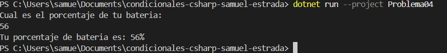

# Problema 04. Alerta de batería

**Estructura elegida:** if simple

**Justificación:** Requiere ejecutar una acción condicional (alerta) si se cumple el umbral, sin rama alternativa.

**Evidencia:**

