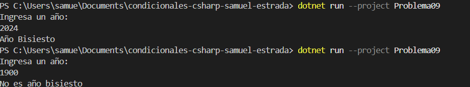

# Problema 09. Año bisiesto

**Estructura elegida:** if con operadores lógicos

**Justificación:** Agrupa condiciones matemáticas complejas de divisibilidad en una sola expresión booleana.

**Evidencia:**

