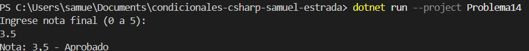

# Problema 14. Estado del aprendiz

**Estructura elegida:** Operador ternario (? :)

**Justificación:** Permite asignar el texto 'Aprobado' o 'Reprobado' en una sola linea segun la nota.

**Evidencia:**

