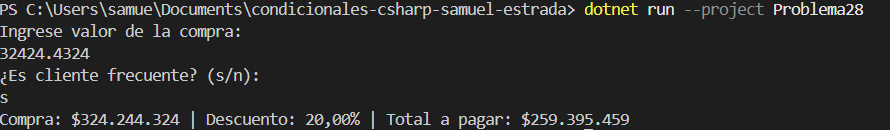

# Problema 28. Descuento por compra

**Estructura elegida:** if-else if-else

**Justificación:** Calcula descuentos por tramos de compra y aplica bonificación por cliente frecuente.

**Evidencia:**

