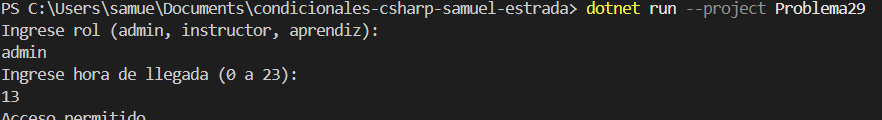

# Problema 29. Control de acceso a la sede

**Estructura elegida:** switch / if-else

**Justificación:** Valida roles de usuario combinados con rangos horarios de ingreso permitidos.

**Evidencia:**

