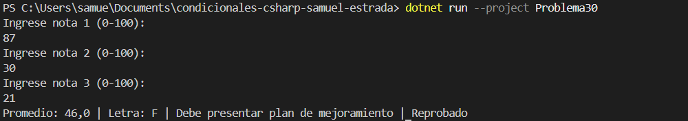

# Problema 30. Boletín de calificaciones (integrador)

**Estructura elegida:** if-else if-else y switch

**Justificación:** Proceso secuencial completo de promedio, letras, retroalimentación y mención de honor.

**Evidencia:**

